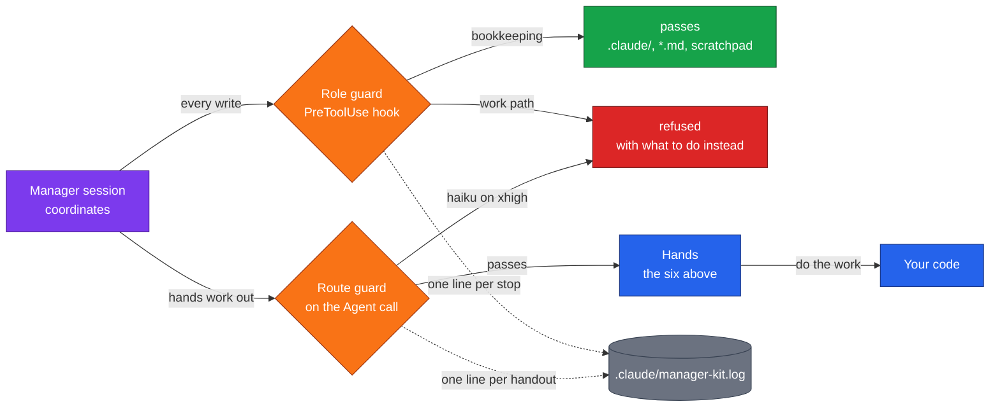

# manager-kit
by Mats Kaposty

[](LICENSE)
[](#install)
[](#details)
[](kit/README.md#verifying-it)

**Coordinate · Delegate · Count**

One Claude Code session coordinates, helper agents do the work, each on a model picked for that kind of job.

> [!IMPORTANT]
> **A coordinating session that starts doing the work itself stops coordinating.**
> **This kit stops it with a hook and hands the work to six ready helpers.**

**Contents:** [What you get](#what-you-get) · [Install](#install) · [Use it](#use-it) · [The six hands](#the-six-hands) · [How it fits together](#how-it-fits-together) · [Details](#details) · [License](#license)

## What you get

- 🧭 **Your main session stays the coordinator.** It plans, hands work out and checks what comes back.
- 🛑 **A guard keeps it that way.** If it tries to write code itself, a hook stops it and says what to do instead.
- 🧰 **Six ready helpers**, from a quick lookup to building a new piece from scratch, each with a suggested model.
- 💰 **Cheaper models where they held up in tests:** Haiku for lookups, Sonnet for checking and repairing, Opus where it made the difference or nothing was measured yet. On the machine it was built on that came to 30.3 percent below all Opus: an estimate, not a quality proof ([details](#details)).
- 📒 **Everything lands in one log**, so stops, crossings and handouts can be counted.
- 🤫 **Quiet.** You only notice it when it stops you.
- 🚪 **You can still cross the line on purpose**, with one line of reason. The crossing is logged.

## Install

In the repository you coordinate:

```
claude plugin marketplace add kaposty/manager-kit --scope local
claude plugin install manager-kit --scope local
claude
```

- Keep `--scope local` on both commands. Without it the guard sits in every project you open.
- Your project's `settings.json` is not touched.

## Use it

- 💬 **Work as usual.** The first session you open in the project is the coordinator.
- 📤 **Ask for work as usual.** When the session would do it itself, the guard pushes it to hand the work to a helper.
- 🔁 **`/manager-kit:take-over`** moves the coordinator role to another running session. Nothing is closed.
- 💵 **`/manager-kit:cost`** shows your own spend per role and model, at list price.

## The six hands

`kit/agents/` ships six subagent definitions. They are shapes of work, not job titles: the name says how deep to think, and `-readonly` says it changes nothing.

| Hand | Effort | Writes? | Reach for it when | Suggested model |
|---|---|---|---|---|
| `low-readonly` | low | no | you need a fact: find, count, list |  |
| `medium` | medium | yes | a clear task, finished, with a command that shows it works |  |
| `high` | high | yes | a change across several files with a few real choices |  |
| `xhigh-readonly` | xhigh | no | find out whether a claim about the code is really true |  |
| `xhigh` | xhigh | yes | fix a known bug, with a test that proves the fix |  |
| `max` | max | yes | build something new where the design is the hard part |  |

- A model or effort named in the call wins over the definition.
- One combination is refused by a hook: haiku on the repair hand `xhigh`.
- Don't want them? Delete the `agents/` directory.

## How it fits together



## Details

<details>
<summary><b>What is measured, and what is not</b></summary>

- **Measured:** the failure it exists for. 39 commits out of the manager line in one day, against that project's own doctrine (2026-09-05).
- **Measured:** the depth ladder. Same prompt, same model, only `effort` differing: 3334 tokens in 17 seconds against 12322 in 129.
- **Measured:** when a hand gets worse. Over 1494 subagent runs on the machine it was built on, 6.2 percent reached 600000 tokens of context and 1.7 percent reached 900000.
- **Saving from the model routing, in three parts:**
  - *Price, estimated:* `tools/mk-cost.sh --what-if` over the UTC days 2026-11-06 and 2026-11-07, on the machine the kit was built on with one private project excluded, put the hand rounds at $440.67 against $632.03 on the newest Opus. 30.3 percent less, an upper bound at list price, and no evidence of quality.
  - *Pair comparisons, measured:* per kind of work, each on one task of kit code, the three decided ones with n = 3 or fewer a side.
  - *Same quality in real work at that price: unmeasured.* No number in this repository says so.
- **No number for your project.** `/manager-kit:cost` measures your own: list price per role and model, read from your transcripts.

</details>

<details>
<summary><b>Switches</b></summary>

- `MANAGER_KIT_NO_ROUTING` in the environment: no handout is refused for its model. Empty and `0` count as unset.
- `.claude/manager-exception`: one line of reason, one crossing. A marker older than five minutes is discarded.
- The kit never sets these for you. It reports them.

</details>

<details>
<summary><b>Limits</b></summary>

- **Protection against a slip, not a sandbox.** It stops a coordinator about to do the work by hand. Somebody who means to get past it gets past it.
- **The Bash side is coarse.** File tools name their path; a shell command is read by a classifier with named holes.
- **It does not decide who coordinates.** The first session takes the role; `/manager-kit:take-over` moves it.
- **It does not start, name or stop sessions.** Only a person can.
- **The record can hold a secret** from a refused command. The kit blacks out known forms and keeps the log out of commits through `.git/info/exclude`, not your `.gitignore`.
- **After you change the kit, the running copy is still the old one** until the version is raised and the plugin updated.
- The full list, each with its size: [Limits measured and left open](kit/README.md#limits-measured-and-left-open).

</details>

<details>
<summary><b>Read next</b></summary>

- [kit/README.md](kit/README.md): everything the kit does, its files, its limits, how to verify it.
- [kit/GUIDE.md](kit/GUIDE.md): how the role is decided, how the guard decides, the model table hand by hand.
- [kit/GOAL.md](kit/GOAL.md): what "done" means, how it would be measured, and what would switch the routing off.

</details>

<details>
<summary><b>Verify it yourself</b></summary>

```
cd kit
bash tests/run.sh
python3 tests/mutate.py
```

The first runs the checks. The second turns each check's subject back, one at a time, and requires that check to go red.

</details>

## License

[MIT](LICENSE). Copyright (c) 2026 Mats Kaposty.
